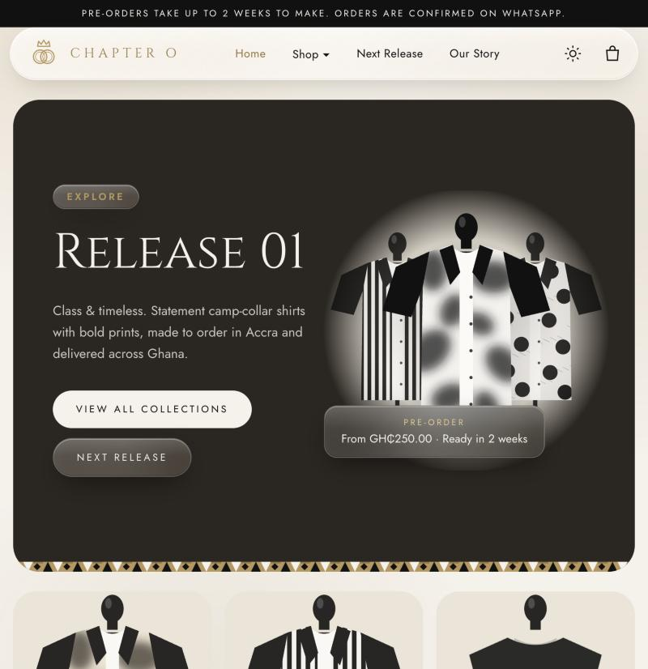
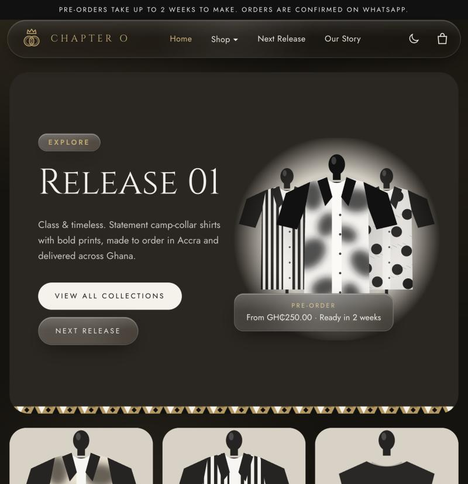
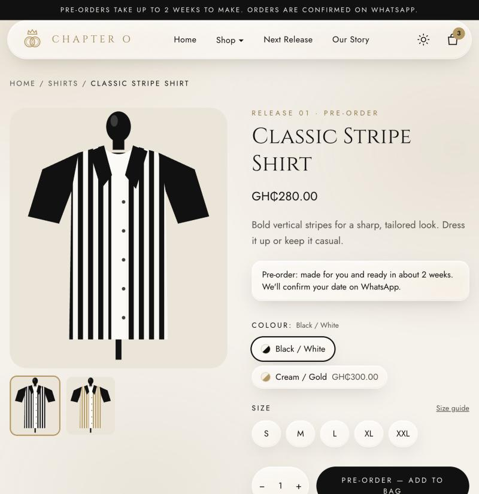
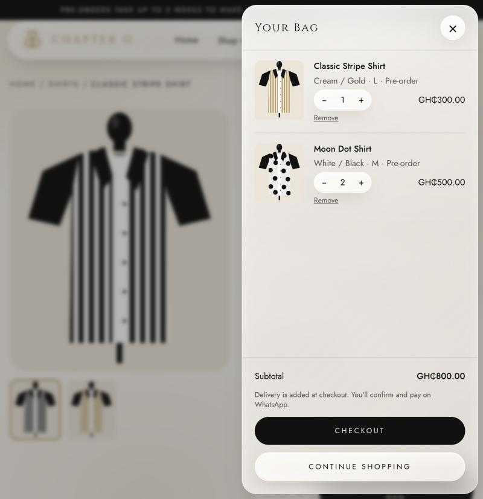
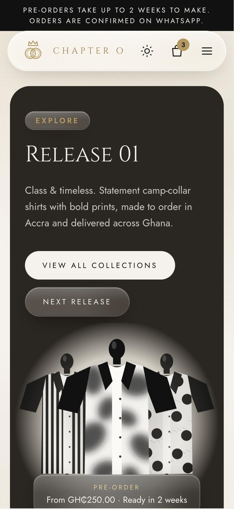

# Chapter O Wear

Online shop for Chapter O Wear. Customers browse, add to a bag, and checkout sends a ready-written order to the shop's WhatsApp — no payment gateway; payment (MoMo, cash, bank) is agreed in the chat.

Layout follows wearghana.com (hero, collection tiles, shop grid with sorting, colour/size product page, side bag, size guide), with Chapter O's poster look: cream, soft gold, black, Cinzel + Jost.

## Screenshots

| Light | Dark |
|---|---|
|  |  |

| Product page | Bag | Phone |
|---|---|---|
|  |  |  |

## Features

- Wear Ghana–style layout: hero banner, category tiles, shop grid with sorting, product page with colour and size options, side bag
- WhatsApp checkout: the order, delivery fee and customer details open in WhatsApp, ready to send — no payment gateway
- Product status: in stock, pre-order or coming soon (with a "Notify me on WhatsApp" button)
- Liquid glass UI: floating frosted header, glass bag, menus, buttons and badges, with a pointer highlight
- Light, dark and system themes from one header icon, remembered per visitor, no flash on load

## Running it

```bash
pnpm install
pnpm dev --port 3100
pnpm build
```

## Swapping placeholders

| What | Where |
|---|---|
| WhatsApp number, socials, notice bar | `lib/store-config.ts` |
| Delivery zones and fees, payment options | `lib/store-config.ts` |
| Products, prices, colourways, status (in stock / pre-order / coming soon) | `lib/products.ts` |
| Product photos | put files in `public/products/` and set `image: "/products/<file>.jpg"` on a colourway — it replaces the drawn shirt |
| Logo | `components/logo.tsx` (`LogoMark`) |
| Brand colours | `app/globals.css` (`:root`) |
| Our story, size chart | `app/our-story/page.tsx`, `app/size-guide/page.tsx` |

Note: edits to `app/globals.css` don't hot-reload with the Tailwind Turbopack loader — restart `pnpm dev` to see them.
